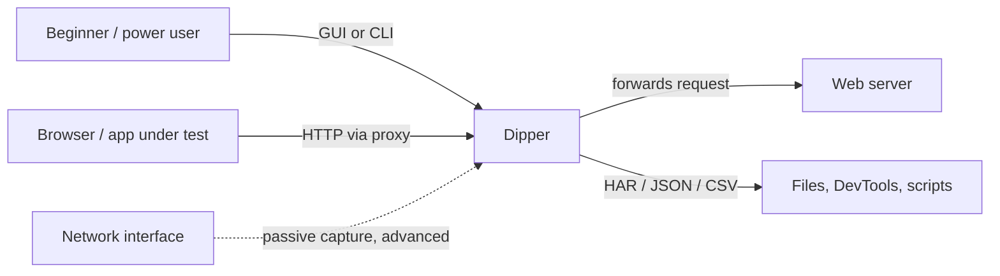
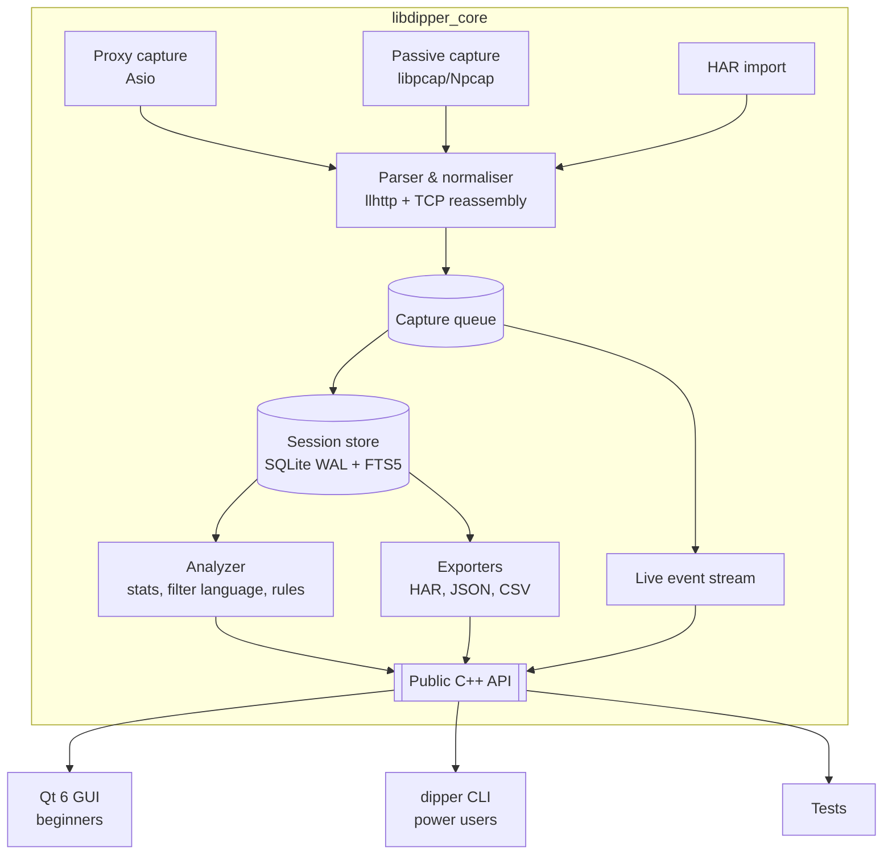
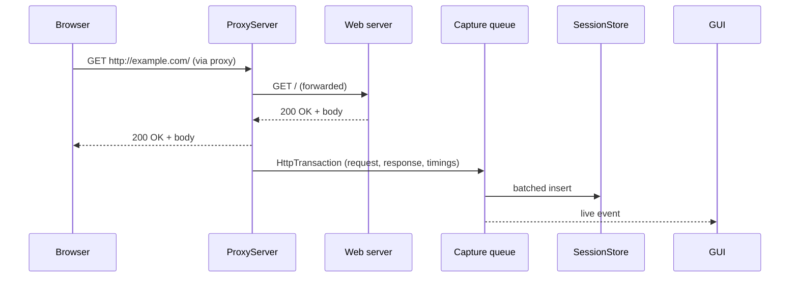

# Architecture overview

> Status: **draft**: complete it in the Phase 1 issue "Write architecture document". Record each
> significant choice as an ADR in [`docs/decisions/`](../decisions/).

## 1. Goals and quality attributes

| Attribute | Target (fill in from the SRS) |
| --- | --- |
| Ease of setup | A first-time user sees their first captured request within _N_ minutes |
| Throughput | Proxy sustains _N_ requests/s on a typical laptop |
| Added latency | Proxy adds less than _N_ ms at p95 |
| Scale | GUI stays responsive with _N_ transactions in a session |
| Portability | Builds and runs on Windows, Linux, macOS |
| Safety | No interception of HTTPS unless the user opts in |

## 2. Context

## 3. Components

| Component | Responsibility | Key types |
| --- | --- | --- |
| Capture | Accept client connections, forward upstream, emit raw bytes + timings | `ProxyServer`, `PcapSource`, `HarImporter` |
| Parser | Turn byte streams into request/response pairs | `HttpParser`, `TcpReassembler` |
| Model | Immutable record of one exchange | `HttpTransaction`, `Headers`, `Timings` |
| Store | Persist and query transactions | `SessionStore`, `Query` |
| Analyzer | Aggregate stats, evaluate filters and alert rules | `FilterExpr`, `Stats`, `RuleEngine` |
| Export | Serialise sessions | `HarExporter`, `CsvExporter` |

### Parser

`HttpParser` (`src/core/include/dipper/http_parser.hpp`) is a thin wrapper around the
[llhttp](https://github.com/nodejs/llhttp) C library (the HTTP/1.x parser used by Node.js).
There is one parser per direction of a connection (`ParserMode::Requests` or `Responses`).
The proxy calls `feed()` with every block it reads from the socket, in whatever pieces the
network delivers, and collects finished `HttpRequest` / `HttpResponse` structs with
`takeRequests()` / `takeResponses()`. `finish()` is called when the connection closes, which
ends a response whose body runs until the close.

- **Framing is done by llhttp:** `Content-Length`, chunked bodies (the stored body is the
  decoded bytes), keep-alive and pipelined messages, 1xx responses, and no body for 204/304.
  A response to `HEAD` has no body either; llhttp cannot know that from the response alone,
  so the proxy calls `setNextResponseIsForHead()`.
- **Body size cap:** at most `maxBodyBytes` (default 10 MiB) of each body are kept;
  `bodySize` always counts the full size.
- **Errors:** invalid input makes `feed()` return false with a message such as
  `HPE_INVALID_HEADER_TOKEN: Invalid header field char`. The parser then stays failed, because
  there is no safe way to find where the next message starts.
- **CONNECT and `Upgrade`:** parsing stops and `isUpgraded()` becomes true; the following
  bytes are a tunnel, not HTTP (handled in #22).
- **Not done here yet:** `Content-Encoding` decoding (#27), timings (#23), a header size
  limit (to revisit when fuzzing the parser, #59).

## 4. Request flow (proxy mode)

## 5. Data model

Defined as plain structs in `src/core/include/dipper/http_transaction.hpp`. Every part of
the tool (proxy, parser, store, analyzer, exporters, GUI) passes these same types around.

| Type | Contents |
| --- | --- |
| `Header` | `name`, `value` |
| `Headers` | `std::vector<Header>`, kept in arrival order; the same name may appear more than once (e.g. `Set-Cookie`) |
| `HttpRequest` | method, URL, HTTP version, headers, body, real body size in bytes |
| `HttpResponse` | status code, reason, HTTP version, headers, body, real body size in bytes |
| `Timings` | start time (wall clock), then DNS, connect, TLS, time to first byte and total, in milliseconds |
| `CaptureMode` | `Proxy`, `HttpsIntercept`, `Import` |
| `TransactionError` | `None`, `DnsFailed`, `ConnectionRefused`, `Timeout`, `ParseError`, `Other` |
| `HttpTransaction` | id, session id, client address/port, server host/port, scheme, request, `hasResponse` + response, timings, capture mode, error + error message |

Design decisions:

- **Headers are a vector, not a map.** HTTP allows repeated headers and their order can
  matter, so a map would lose information. Header names are case-insensitive, so lookups go
  through `findHeader(headers, name)`, which returns the first match ignoring case.
- **"Not measured" is `kNotMeasured` (-1).** A phase that did not happen (no TLS on plain
  HTTP, no response after a DNS failure) is -1, because 0 ms is a real measurement.
- **Ids are 0 until stored.** The SQLite store (#25) assigns `id` and `sessionId`.
- **Bodies are held in memory as `std::string` for now.** `bodySize` always records the real
  size so a body can later be cut short (size cap, see section 7) without losing that fact.

Invariants, checked by `findProblem(transaction)` (returns "" when the transaction is valid):

1. A transaction has either a response or an error, never both and never neither.
2. A response status code is between 100 and 599.
3. Body sizes are not negative.
4. Timings are either `kNotMeasured` or not negative, and time to first byte is not longer
   than the total time.

## 6. Threading model

_To decide (ADR):_ Asio `io_context` on a small thread pool for network I/O; one writer thread
draining the capture queue into SQLite in batches; the GUI thread receives live events via a
Qt queued signal.

## 7. Storage

One SQLite file per session (`*.dipper`), WAL mode, indexes on time, host, status, method;
FTS5 table over URLs and text bodies; large bodies stored with a size cap.

## 8. Security and ethics

HTTPS interception is opt-in, uses a locally generated CA whose private key never leaves the
user's machine, and is clearly indicated in the UI. Proxy listens on `127.0.0.1` by default.
