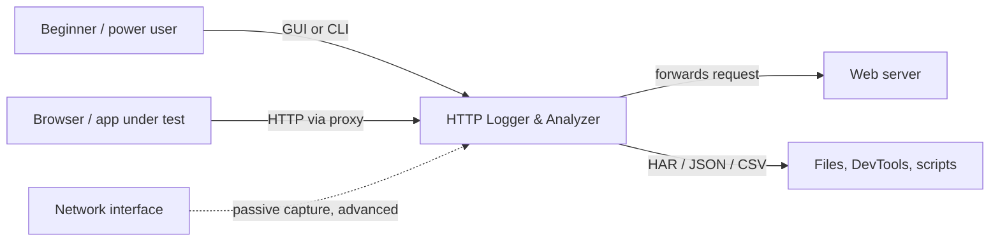
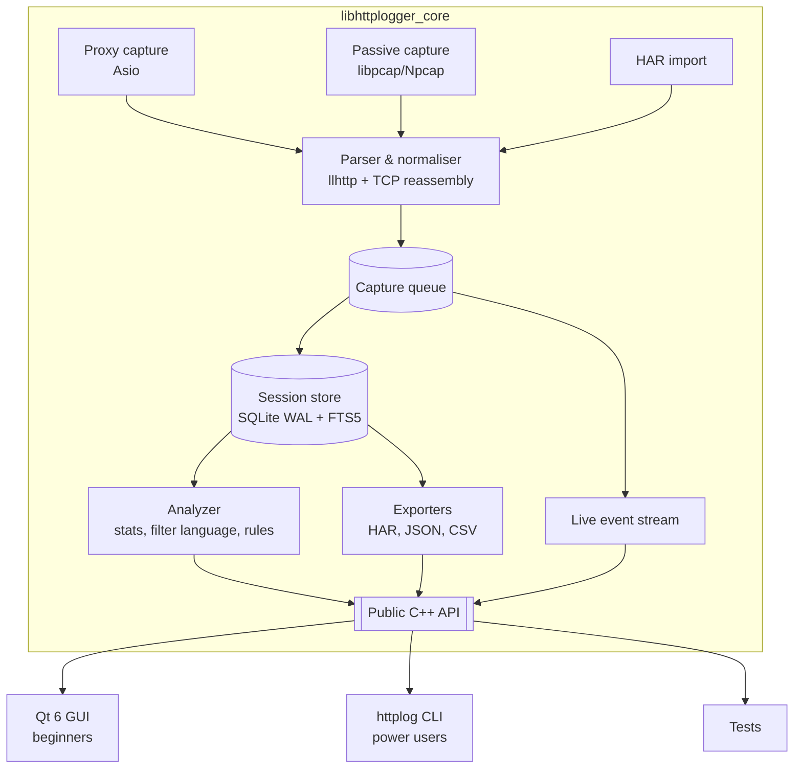
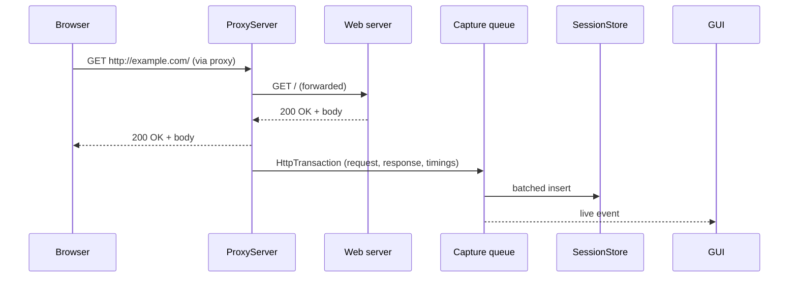

# Architecture overview

> Status: **draft**: complete it in the Phase 1 issue "Write architecture document". Record each
> significant choice as an ADR in [`docs/decisions/`](../decisions/).

## 1. Goals and quality attributes

| Attribute | Target (fill in from the SRS) |
| --- | --- |
| Ease of setup | A first-time user sees their first captured request within _N_ minutes |
| Throughput | Proxy sustains _N_ requests/s on a typical laptop |
| Added latency | Proxy adds less than _N_ ms at p95 |
| Scale | GUI stays responsive with _N_ transactions in a session |
| Portability | Builds and runs on Windows, Linux, macOS |
| Safety | No interception of HTTPS unless the user opts in |

## 2. Context

## 3. Components

| Component | Responsibility | Key types |
| --- | --- | --- |
| Capture | Accept client connections, forward upstream, emit raw bytes + timings | `ProxyServer`, `PcapSource`, `HarImporter` |
| Parser | Turn byte streams into request/response pairs | `HttpParser`, `TcpReassembler` |
| Model | Immutable record of one exchange | `HttpTransaction`, `Headers`, `Timings` |
| Store | Persist and query transactions | `SessionStore`, `Query` |
| Analyzer | Aggregate stats, evaluate filters and alert rules | `FilterExpr`, `Stats`, `RuleEngine` |
| Export | Serialise sessions | `HarExporter`, `CsvExporter` |

## 4. Request flow (proxy mode)

## 5. Data model (draft)

`HttpTransaction`: id, session id, client address, server host/port, scheme, method, URL,
request headers/body ref, status code, response headers/body ref, sizes, timings
(start, DNS, connect, TLS, TTFB, total), capture mode, error (if any).

## 6. Threading model

_To decide (ADR):_ Asio `io_context` on a small thread pool for network I/O; one writer thread
draining the capture queue into SQLite in batches; the GUI thread receives live events via a
Qt queued signal.

## 7. Storage

One SQLite file per session (`*.httplog`), WAL mode, indexes on time, host, status, method;
FTS5 table over URLs and text bodies; large bodies stored with a size cap.

## 8. Security and ethics

HTTPS interception is opt-in, uses a locally generated CA whose private key never leaves the
user's machine, and is clearly indicated in the UI. Proxy listens on `127.0.0.1` by default.
